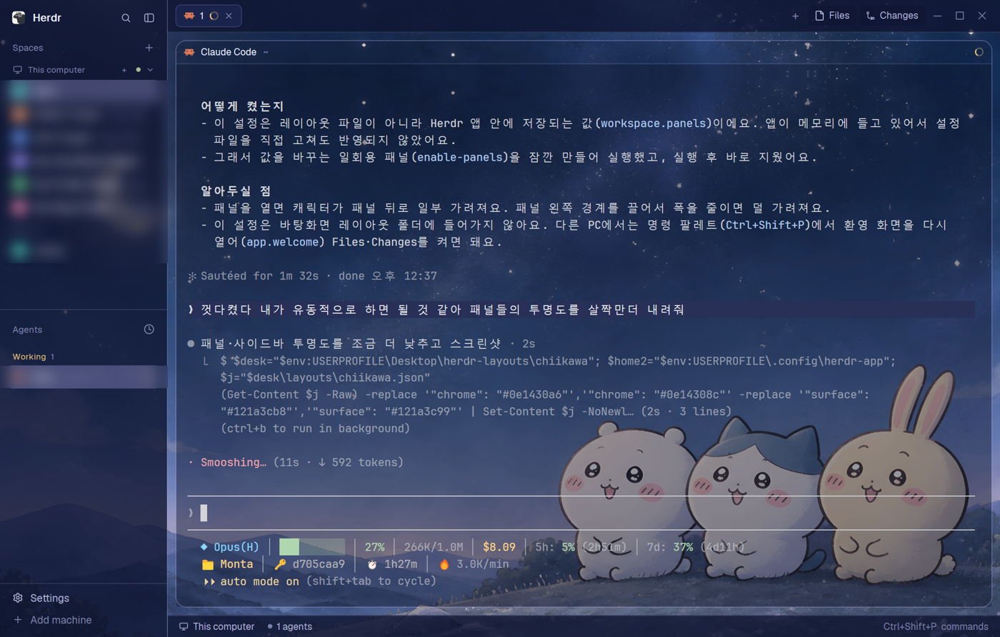

# herdr-chiikawa

[Herdr](https://herdr.dev) 앱에 쓰는 **치이카와 밤하늘 레이아웃**과 **Files 끌어다 놓기** 기능이에요.

Files 패널에서 파일이나 폴더를 터미널로 끌어다 놓으면 그 **절대경로가 바로 입력**돼요.



## 기능

### Files 끌어다 놓기 (두 모양 공통)
- Files 패널에서 파일/폴더를 누른 채 패널 밖으로 끌면 이름표가 커서를 따라와요.
- 터미널 위에서 놓으면 절대경로가 입력돼요. Enter는 누르지 않아요.
- 패널 위로 돌아와서 놓으면 취소돼요.
- 경로에 공백 등이 있으면 `"따옴표"`, `$`나 `` ` ``가 있으면 `'작은따옴표'`로 감싸고, 끝에 공백을 하나 붙여요.
- ssh로 연결한 다른 컴퓨터(Linux/Windows) 공간에서는 그 컴퓨터의 파일 목록과 경로가 나와요.

### 치이카와 레이아웃에만 있는 것
- 밤하늘 배경, 반투명 터미널, 남색 유리 느낌 색
- 상단 탭바의 **Files / Changes / GitHub** 버튼
- Files 패널에서 파일을 바로 고치고 `Ctrl+S`로 저장, `..`로 상위 폴더, `.md` 미리보기, 디스크 변경 자동 반영
- GitHub 이슈·PR 패널 (`gh` CLI 필요)

## 설치

1. 이 저장소를 내려받아요. **Code → Download ZIP** 후 압축을 풀면 돼요.
2. Herdr를 켠 상태에서 `install.cmd`를 더블클릭해요.
3. 모양을 골라요.
   ```
   1) 치이카와 밤하늘 레이아웃 (배경, 투명도, Files/Changes/GitHub 패널 + 끌어다 놓기)
   2) 기본 Herdr 모양 그대로 (끌어다 놓기만 추가)
   ```
   그냥 Enter를 누르면 1번이에요.

설치가 끝나면 그 레이아웃으로 바로 바뀌고, 오른쪽에 Files 패널이 열려 있어요.

PowerShell에서 직접 설치할 수도 있어요.
```powershell
.\install.ps1 -Style chiikawa
.\install.ps1 -Style basic
.\install.ps1 -Style basic -Layout <내 레이아웃이름>   # 내 레이아웃의 Files 패널에만 연결 (.bak 백업)
```

`basic`은 Herdr 기본 레이아웃(`main`)을 `main-drag`로 복제해서 연결해요. 기본 레이아웃 원본은 건드리지 않아요.

### GitHub 패널 (치이카와)
[GitHub CLI](https://cli.github.com)가 설치되고 로그인돼 있어야 해요.
```powershell
gh auth login
```

## 알아둘 점

- **Windows 전용**이에요. 경로를 클립보드에 넣고 붙여넣는 방식이라, 클립보드 내용이 그 경로로 바뀌어요.
- 경로는 놓은 곳이 아니라 **마지막으로 선택한 터미널**에 들어가요. 화면을 나눴다면 넣을 터미널을 먼저 한 번 클릭하세요.
- Files 패널이 안 보이면 상단 오른쪽 **Files** 버튼을 누르세요. 버튼도 없으면 `Ctrl+Shift+P` → Welcome에서 Files를 켜세요.
- Claude Code를 쓴다면 `/theme` → `dark-ansi`로 바꾸면 밤하늘 색과 잘 어울려요.

## 되돌리기 / 지우기

`Ctrl+Shift+L`로 다른 레이아웃을 고르면 원래대로 돌아가요.

완전히 지우려면 `%USERPROFILE%\.config\herdr-app` 안에서 아래를 지우세요.

| 모양 | 지울 것 |
|---|---|
| 치이카와 | `layouts\chiikawa.*`, `backgrounds\chiikawa-starry-br.jpg`, `mods\chiikawa-*` |
| 기본 모양 | `layouts\main-drag.json`, `mods\files-drag-path`, `mods\files-drag-path-layer` |

## 구성

```
install.cmd / install.ps1   설치 (모양 선택)
chiikawa/                   치이카와 레이아웃, 배경, 모드 5개
  layouts/  backgrounds/
  mods/chiikawa-files         Files 패널 (끌어다 놓기, 편집·저장)
  mods/chiikawa-files-drag    끌기 중 이름표, 놓으면 경로 입력
  mods/chiikawa-tabs          탭바 (Files / Changes / GitHub 버튼)
  mods/chiikawa-changes       Changes 패널
  mods/chiikawa-github        GitHub 이슈·PR 패널
basic/                      기본 모양용 모드 2개
  mods/files-drag-path        Files 패널 (기본 files + 끌어다 놓기)
  mods/files-drag-path-layer  끌기 중 이름표, 놓으면 경로 입력
```

## 크레딧

- `chiikawa-github` 패널과 클립보드 붙여넣기 아이디어는 [ssenu/Herdr-UI](https://github.com/ssenu/Herdr-UI)를 바탕으로 했어요 (Apache-2.0, `chiikawa/mods/chiikawa-github/LICENSE`).
- 치이카와(ちいかわ) 캐릭터의 권리는 원작자 나가노(ナガノ)에게 있어요. 이 저장소는 비공식 팬 제작물이에요.
